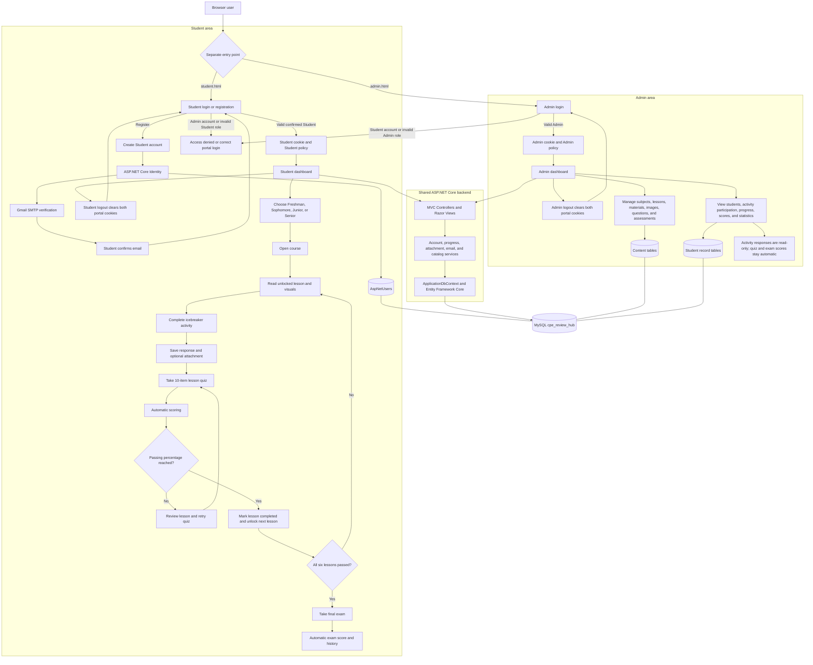

# COLMS: CentOs Learning Management System system overview

## End-to-end system flow

The standalone presentation image is available as
[`CPE-REVIEW-HUB-SYSTEM-FLOW.png`](CPE-REVIEW-HUB-SYSTEM-FLOW.png).



The Student and Admin interfaces share the MVC application and database, but
their authentication cookies, authorization policies, routes, navigation, and
permitted operations remain separate. Every database read or change passes
through a protected controller/service and `ApplicationDbContext`; a hidden link
or manually typed URL cannot bypass server-side authorization.

## Database architecture

- **Server/provider:** MySQL 8 (`MySQL80` locally) through `MySql.EntityFrameworkCore` 10.0.9.
- **Database:** `cpe_review_hub`.
- **DbContext:** `CPE_Review_Hub.Data.ApplicationDbContext`.
- **Connection:** `ConnectionStrings:ReviewHub` is stored in Windows .NET user-secrets, outside Git.
- **Schema:** EF Core migrations in `src/CPE-Review-Hub/Data/Migrations`; setup applies pending migrations without recreating the database.

The schema has 19 tables:

- Identity: `AspNetUsers`, `AspNetUserClaims`, `AspNetUserLogins`, `AspNetUserTokens`
- Content: `AcademicLevels`, `Subjects`, `Lessons`, `ReviewMaterials`, `LessonActivities`, `LessonImages`
- Assessments: `Questions`, `Choices`, `Assessments`, `AssessmentQuestions`
- Student records: `ActivitySubmissions`, `SubmissionAttachments`, `AssessmentAttempts`, `AttemptAnswers`
- Schema history: `__EFMigrationsHistory`

## How MySQL runs in the system

MySQL and the ASP.NET Core application are two separate processes. The local
`MySQL80` Windows service listens on `127.0.0.1:3306` and owns the
`cpe_review_hub` database. From `src/CPE-Review-Hub`, `dotnet run --launch-profile http` starts the web
application on `http://localhost:5293`. The application then connects to MySQL
with the dedicated `cpe_review_hub` database user.

```text
Browser
  → ASP.NET Core / Kestrel on localhost:5293
  → Controller and service rules
  → ApplicationDbContext
  → MySql.EntityFrameworkCore
  → MySQL80 on 127.0.0.1:3306
  → cpe_review_hub tables
  → Razor View returned to the browser
```

`ApplicationDbContext` is created for a web request and exposes C# entity sets
such as `Subjects`, `Lessons`, `ActivitySubmissions`, and `AssessmentAttempts`.
Entity Framework Core converts LINQ reads into parameterized MySQL `SELECT`
statements. `Add`, property changes, and `Remove`, followed by
`SaveChangesAsync`, become `INSERT`, `UPDATE`, and `DELETE` statements. Returned
rows are mapped back into C# models before a Razor View generates the HTML.

### Common data flows

- **Student registration:** Identity checks normalized email uniqueness, hashes
  the password, and inserts an unconfirmed Student in `AspNetUsers`. The plain
  password is never stored. Gmail sends the confirmation link, and successful
  confirmation updates `EmailConfirmed`.
- **Login:** Identity selects the account by email and verifies the submitted
  password against `PasswordHash` in application code. A valid account receives
  the separate Student or Admin authentication cookie. Failed-attempt and lockout
  information is persisted in `AspNetUsers`.
- **Lesson display:** the Student controller reads the Lesson together with its
  Subject, Review Materials, published Lesson Images, Activity, and Assessment.
  Image metadata is in MySQL; repository-owned SVG files are served from
  `src/CPE-Review-Hub/wwwroot/images/lessons`.
- **Activity submission:** the first response inserts an `ActivitySubmissions`
  row; a later response updates that same row. The unique
  `(UserId, LessonActivityId)` index prevents duplicate completion records.
  Uploaded evidence is stored in `SubmissionAttachments`; its file bytes use a
  MySQL `longblob` column.
- **Quiz or exam:** MySQL supplies the Assessment, mapped Questions, and Choices.
  Submission creates an `AssessmentAttempt` and `AttemptAnswers`; the server
  calculates and stores the score, percentage, and pass result. Admin does not
  manually edit these results.
- **Progress:** `StudentProgressService` derives lesson and course progress from
  completed activity submissions and passed assessment attempts, so the system
  does not need a second conflicting progress record.

### Setup, migrations, and normal startup

`scripts/Setup CPE Review Hub.cmd` verifies the service and credentials, stores the
connection string in Windows .NET user-secrets, and applies pending EF Core
migrations. Migration names already recorded in `__EFMigrationsHistory` are not
applied again. Normal `dotnet run` uses the existing schema and does not recreate
or reset the database on every startup.

The MySQL connection string and Gmail App Password are outside the repository.
They persist in Windows user-secrets, so they do not need to be pasted for every
run. The application uses a dedicated database account instead of MySQL `root`.

If MySQL80 is stopped, authentication and content queries cannot reach the
database. `DatabaseErrorMiddleware` converts supported database failures into a
safe service-unavailable page without exposing credentials. Starting MySQL80 and
refreshing the request restores access; rebuilding the application is normally
unnecessary.

MySQL Workbench and phpMyAdmin are optional management interfaces. They do not
host the database and do not need to remain open. XAMPP is also unnecessary when
the application uses the standalone MySQL80 service.

## Relationship diagram

```text
AspNetUsers (Student/Admin)
  ├──< ActivitySubmissions >── LessonActivities ──1 Lessons ──< Subjects
  │          └──< SubmissionAttachments              │           │
  │                                                   │           └── AcademicLevels
  └──< AssessmentAttempts >── Assessments >───────────┘
               │                  │
               └──< AttemptAnswers│
                                  └──< AssessmentQuestions >── Questions ──< Choices

Lessons ──< ReviewMaterials
Lessons ──< LessonImages (local path, alt text, caption, display order)
Lessons ──0..1 LessonActivities
Subjects ──< Assessments (lesson quizzes and final exams)
```

`1` means one, `0..1` means optional one, and `<` means many. A Student can submit
one response per activity because `(UserId, LessonActivityId)` is unique. The
submission itself is the completion record. `CompletedAtUtc` records first
completion and `UpdatedAtUtc` records later edits. Attachments belong to the
submission. Activities have no grade, score, feedback, approval, or pass/fail column.

## Learning flow

```text
Read lesson
  → submit icebreaker activity (recorded Completed)
  → lesson quiz unlocks
  → quiz is automatically scored
      ├── below passing percentage: current lesson available; next lesson locked
      └── at/above passing percentage: lesson completed; next lesson unlocked
  → all six lesson quizzes passed
  → final exam unlocks and is automatically scored
```

Each activity records a response type and optional choices/matches. Empty responses
are rejected, but there is no minimum-character rule. Admin can edit an icebreaker's
title, instructions, expected output, response type, options, and published status
in the existing lesson editor. Student activity monitoring is read-only,
with Student, Course, Lesson, and date filters plus response/file viewing.
Statistics keep activity participation separate from quiz and exam scores.

## CRUD operations

CRUD means Create, Read, Update, and Delete. The application does not issue
database commands directly from a Razor page. A form or link reaches an MVC
controller, the controller validates a dedicated ViewModel, and Entity Framework
Core translates the approved operation into a MySQL `INSERT`, `SELECT`, `UPDATE`,
or `DELETE` statement.

```text
Browser form or link
  → MVC controller
  → authorization and anti-forgery checks
  → ViewModel validation
  → ApplicationDbContext / Entity Framework Core
  → MySQL
  → redirect or rendered Razor View
```

### Admin content operations

| Module | Create | Read | Update | Delete |
|---|:---:|:---:|:---:|:---:|
| Subjects | Yes | Yes | Yes | Yes |
| Lessons and icebreaker definitions | Yes | Yes | Yes | Yes |
| Review materials | Yes | Yes | Yes | Yes |
| Lesson images and metadata | Yes | Yes | Yes | Yes |
| Quiz/exam questions and choices | Yes | Yes | Yes | Yes |
| Quiz and final-exam settings | Seeded | Yes | Yes | No public delete action |
| Students | Student registration | Yes | Activate/deactivate | No destructive delete action |
| Activity submissions | No | Read-only | No | No |
| Quiz and exam results | No | Read-only | No | No |
| Statistics | No | Read-only | No | No |

The full content CRUD controllers are `SubjectsController`, `LessonsController`,
`MaterialsController`, `LessonImagesController`, and `QuestionsController` in the
Admin area. Create and edit forms use GET requests, while Save and confirmed Delete
operations use POST requests. Global automatic anti-forgery validation protects
these modifying requests. Every Admin controller is protected by the Admin policy.

Deleting a parent content record follows the relationships configured in
`ApplicationDbContext`. Dependent lesson content can cascade with its parent,
while an Academic Level referenced by Subjects uses restricted deletion. Question
deletion also checks assessment mappings so shared or still-used questions are not
carelessly removed.

### Student-owned operations

Students have intentionally limited data operations:

- Registration creates a Student account; Profile reads and updates only the
  signed-in student's information.
- An activity submission is created on its first submission and updated on later
  submissions. The unique `(UserId, LessonActivityId)` index prevents duplicate
  completion rows.
- A Student may upload, read, and remove only attachments belonging to that
  Student's activity submission.
- Starting and submitting a quiz or exam creates an `AssessmentAttempt` and its
  `AttemptAnswers`. The server calculates the score and students cannot rewrite or
  delete a submitted academic result.

Activity responses and results do not expose general Admin CRUD. Admin activity
access is participation monitoring only, and quiz/exam results remain automatically
calculated. Account deactivation is used instead of destructive Student deletion so
progress, attempts, responses, and attachments are not accidentally lost.

Seeded lesson visuals are selected by stable course code and lesson title through
`LessonVisualManifest`, never by database ID. The current audit retains 148
topic-specific diagrams and intentionally leaves 56 lessons without a seeded
image. Custom Admin uploads remain separate and are not deleted by catalog reseeding.

## Migration history

1. `InitialAccounts` — Identity users and account fields.
2. `LearningContentFoundation` — levels, subjects, lessons, and materials.
3. `CourseActivitiesAndAssessments` — activities, questions, quizzes, and exams.
4. `StudentLearningProgress` — submissions, attempts, and selected answers.
5. `RenameAcademicLevels` — Sophomore, Junior, and Senior labels.
6. `ActivitySubmissionAttachments` — uploaded activity evidence.
7. `RequireStudentEmailConfirmation` — verified-email requirement.
8. `ActivitySubmissionGrading` — historical grading fields.
9. `RemoveActivityGrading` — removes unused grading fields after confirming the
   live database has zero graded submissions; responses and files remain intact.
10. `LessonImagesAndActivityTypes` — adds lesson-image metadata plus typed activity
    controls and options; existing submissions remain intact.

## GitHub versus MySQL

GitHub contains application source: models, controllers, services, Razor views,
CSS/JavaScript/images, migrations, scripts, tests, documentation, and package
configuration. Git history records code changes.

MySQL contains runtime data: accounts and password hashes, content rows, activity
responses and attachment bytes, quiz/exam attempts and answers, and migration
history. GitHub does **not** contain student records, submitted files, live scores,
MySQL passwords, Gmail App Passwords, or authentication cookies. Secrets remain
in user-secrets or runtime storage and are excluded from Git.
